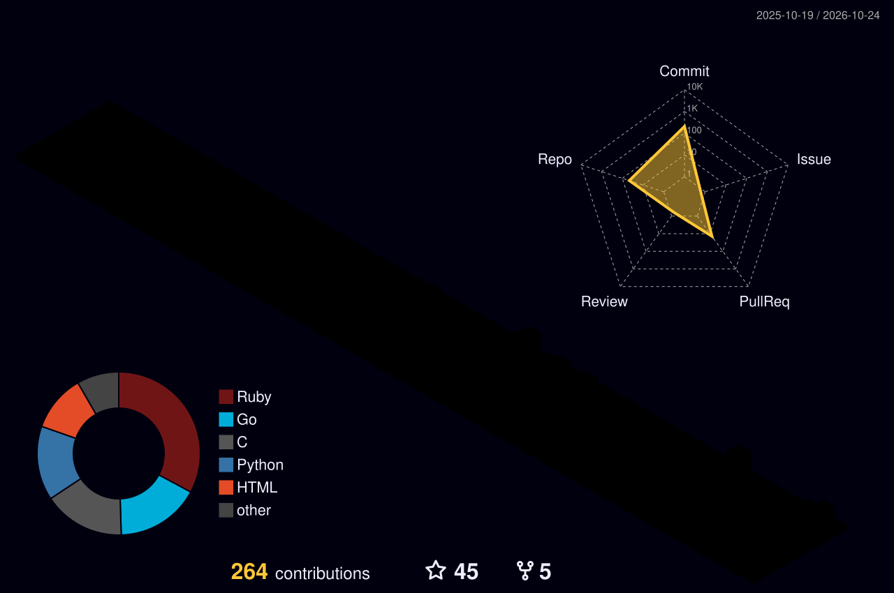

<!-- header -->
<p align="center">
  
</p>

<p align="center">
  <a href="https://github.com/binRick"></a>
  <a href="https://github.com/binRick?tab=repositories"></a>
  
</p>

<!-- typing ticker -->
<p align="center">
  <a href="https://github.com/binRick">
    
  </a>
</p>

---

### 🧑‍💻 `cat ~/about.txt`

```c
struct rick {
    const char *location  = "Tampa, FL 🌴";
    const char *daily     = "tmux + vim + ssh";
    const char *loves[]   = { "ANSI escape codes", "terminal UIs", "meson", "darwin hacks" };
    const char *infra[]   = { "RHEL", "Ansible", "Docker", "NSX", "HAProxy", "WireGuard", "ZFS" };
    int         repos     = 300;  /* and counting */
};
```

### 🛠️ Toolbox

| | |
|---|---|
| **Languages** |         |
| **Build / Dev** |      |
| **Infra / Ops** |         |

### 📌 Featured Projects

<p align="center">
  <a href="https://github.com/binRick/c_ansi"></a>
  <a href="https://github.com/binRick/node-block-ssh-scanner-traffic"></a>
  <a href="https://github.com/binRick/c_darwin"></a>
  <a href="https://github.com/binRick/tls-ca-fetch"></a>
  <a href="https://github.com/binRick/ZFSManager"></a>
  <a href="https://github.com/binRick/free-webui"></a>
</p>

### 📊 Stats

<p align="center">
  
  
</p>

<p align="center">
  
</p>


### 🧊 3D Contributions

<p align="center">
  
</p>

### 🐍 Snake

<picture>
  <source media="(prefers-color-scheme: dark)" srcset="https://raw.githubusercontent.com/binRick/binRick/output/github-contribution-grid-snake-dark.svg" />
  <source media="(prefers-color-scheme: light)" srcset="https://raw.githubusercontent.com/binRick/binRick/output/github-contribution-grid-snake.svg" />
  
</picture>

<p align="center">
  
</p>
